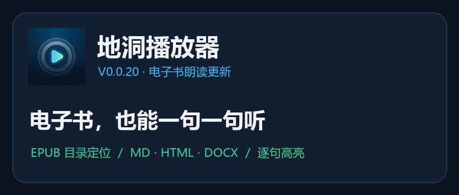
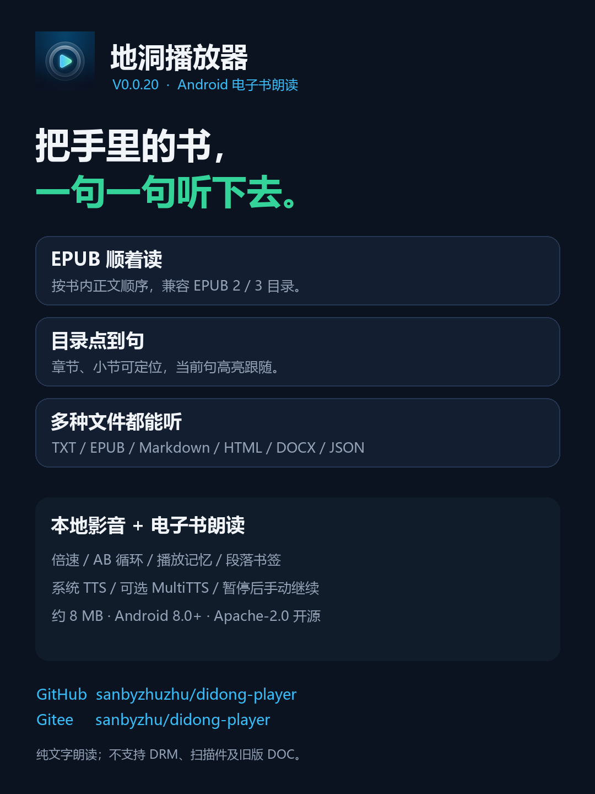
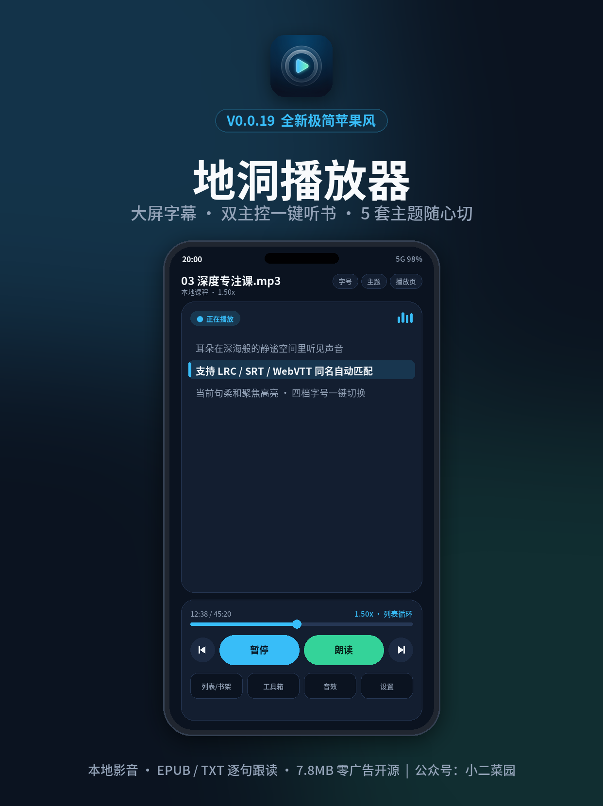
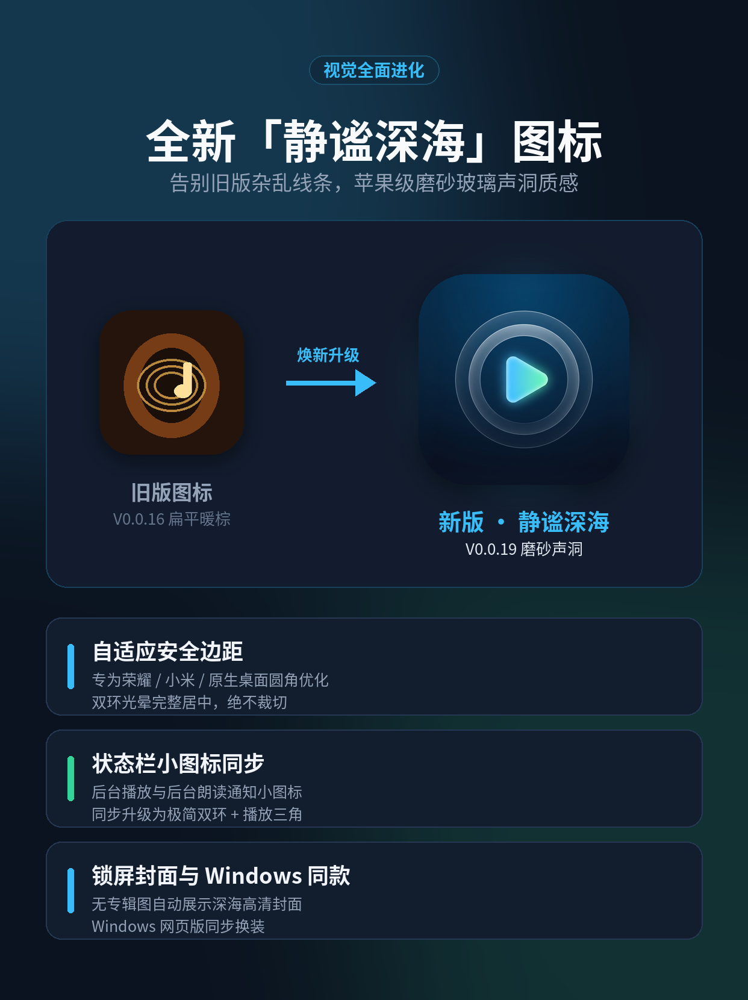

# 地洞播放器

地洞播放器是一个【安卓】优先的本地音频、视频和电子书朗读播放器（约 8 MB）。它使用 AndroidX Media3/ExoPlayer 作为播放核心，面向听课、听书、整理本地影音和长文本朗读等场景。

当前版本：`V0.0.20`



[GitHub 源码](https://github.com/sanbyzhuzhu/didong-player) · [Gitee 镜像](https://gitee.com/sanbyzhu/didong-player) · [下载安装包](https://github.com/sanbyzhuzhu/didong-player/releases/tag/v0.0.20)

本版重点：EPUB 正文顺序与章节目录、Markdown / HTML / DOCX 纯文字朗读、逐句高亮跟随。 

## 界面预览



## 功能特性

- 扫描 SAF 文件夹，递归识别常见音频/视频格式。
- 支持直接打开单个音频/视频文件，并维护“打开的文件”列表。
- 按文件名自然排序，文件名包含数字时优先按数字排序。
- 支持音频、视频播放，视频可进入全屏和画中画。
- 支持播放位置记忆、文件夹级音频/视频独立倍速记忆。
- 支持 0.25x 到 8.0x 倍速。
- 支持顺序播放、单曲循环、列表循环、随机循环。
- 支持 AB 循环、A/B 点微调和按媒体文件记忆。
- 支持播放列表、收藏、最近播放、书签和列表清理。
- 支持系统音效增强、响度增益、低音增强、立体感增强和五段 EQ。
- 支持 LRC/SRT/WebVTT 歌词字幕导入、同名自动匹配、偏移调整和三行滚动高亮显示。
- 播放进度每 5 秒自动保存；摘掉耳机、来电或音频被占用时自动暂停，需手动点播放才继续。
- 支持 TXT、EPUB、Markdown、HTML、DOCX、JSON 的纯文字导入与系统 TTS 朗读，后台朗读同样遵守「暂停后手动继续」。
- EPUB 按 spine 顺序阅读，支持 EPUB 3 nav / EPUB 2 NCX 目录及章节内锚点；Markdown、HTML、DOCX 标题可作为目录。详见 [电子书导入说明](docs/ebook-import.md)。
- 支持朗读书架、章节目录、段落书签、文本搜索和后台朗读通知。
- 支持朗读背景音乐和可选 MultiTTS 本地接口。
- 提供 Windows 免安装网页尝鲜版。

## 下载

Android APK、完整源码 ZIP、Windows 免安装浏览器版及 SHA256 校验文件统一放在 [GitHub V0.0.20 发布页](https://github.com/sanbyzhuzhu/didong-player/releases/tag/v0.0.20)。Gitee 同步源码和更新说明，可通过本页的下载入口获取相同安装包。

本地本次双平台发布归档位于：

```text
release/v0.0.20_双平台同步与宣发更新/
```

当前 APK 使用调试签名；从本项目已发布的同签名版本升级时可覆盖安装。公开下载附件与 Git 源码历史分开保存，APK 不提交进 Git 历史。Windows 包为浏览器原型，本次新增电子书解析针对 Android。

### 统一发布打包

以后发布统一放在 `release/v版本号_说明/`，包括 APK、源码 ZIP、现有 Windows 免安装网页版 ZIP、发布说明和 SHA256 校验文件。
源码来自当前工作区，包含尚未提交的修改，不包含本机配置、缓存、旧发布包或签名私钥。

更新 `app/build.gradle` 的版本号与 `CHANGELOG.md` 后，运行（需要 Python 3）：

```powershell
python tools/package_release.py --description "EPUB目录与多格式朗读"
```

脚本会重新构建 debug APK，校验版本并打包。如果依赖已缓存可追加 `--offline`。同名目录已存在时会停止，避免覆盖历史版本。
Windows 包为现有浏览器原型，并非原生 EXE；解压后双击启动 BAT 或使用 Edge/Chrome 打开 HTML。

## 构建

环境要求：

- JDK 17 或更高版本
- Android SDK
- Gradle Wrapper 已包含在仓库中

构建 debug APK：

```powershell
.\gradlew.bat assembleDebug
```

生成的 APK 位于：

```text
app\build\outputs\apk\debug\app-debug.apk
```

## Windows 尝鲜版

Windows 上可双击 [`启动地洞Windows版.bat`](windows/启动地洞Windows版.bat)，或直接用 Edge/Chrome 打开 [`DidongPlayer.html`](windows/DidongPlayer.html)。

这是基于浏览器本地能力实现的免安装原型。浏览器出于安全限制不会永久保存文件授权，下次打开通常需要重新扫描文件夹。

## MultiTTS 接口

设置中心可开启“使用MultiTTS接口”，会把 TXT 朗读分段发送到：

```text
http://127.0.0.1:8774/forward
```

如果 MultiTTS 未启动、接口失败或返回不可播放音频，应用会自动退回系统 TTS 朗读。

## 开源协议

本项目使用 [Apache License 2.0](LICENSE) 开源。你可以在许可证允许的范围内使用、修改和分发代码；分发时请保留版权声明和许可证文本。

## 贡献

欢迎通过 Issue 反馈问题或提出想法，有问题也可与我取得联系(公众号：小二菜园，邮箱254850837@qq.com)。提交代码前请先阅读 [CONTRIBUTING.md](CONTRIBUTING.md)。

## 后续路线

1. 继续拆分播放控制、TTS、列表管理和数据层。
2. 将 SharedPreferences/JSON 逐步迁移到 Room。
3. 改进 Windows 桌面版本，评估 Kotlin Multiplatform、Compose Desktop 或 Flutter。
4. 评估投屏能力，按设备能力接入 MediaRouter、Google Cast、DLNA 或 Miracast。
